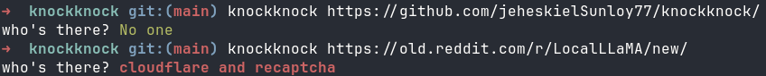

# knockknock

`knockknock` is a Go CLI for detecting whether a page is protected by an
antibot, WAF, or CAPTCHA vendor.



## AI Agent Quickstart

Copy and paste this prompt to your AI coding agent (Claude Code, Cursor, Windsurf, Codex, Antigravity, etc.) to install both the CLI and the skill:

```text
Install the knockknock CLI and its AI agent skill:
1. Run: curl -sSf https://raw.githubusercontent.com/jeheskielSunloy77/knockknock/main/install.sh | sh
2. Run: knockknock skill install -g (or `npx skills add jeheskielSunloy77/knockknock`)
3. Verify: knockknock --version
Use knockknock whenever diagnosing 403/429 HTTP blocks, checking antibot/WAF defenses (Cloudflare, Akamai, DataDome, Kasada, AWS WAF, etc.), or profiling scraping targets. Always pass `--json`.
```

### Manual Skill Installation

```sh
# Via skills.sh / npx
npx skills add jeheskielSunloy77/knockknock

# Or using knockknock CLI once installed
knockknock skill install     # project-level (.agents/skills/knockknock/SKILL.md)
knockknock skill install -g  # global (~/.agents/skills/knockknock/SKILL.md)
```

## Install

### curl (pre-built binary)

```sh
curl -sSf https://raw.githubusercontent.com/jeheskielSunloy77/knockknock/main/install.sh | sh
```

Pass a specific version:

```sh
curl -sSf https://raw.githubusercontent.com/jeheskielSunloy77/knockknock/main/install.sh | VERSION=0.1.0 sh
```

### go install

```sh
go install github.com/jeheskielSunloy77/knockknock/cmd/knockknock@latest
```

### build from source

```sh
git clone https://github.com/jeheskielSunloy77/knockknock.git
cd knockknock
go build -o knockknock ./cmd/knockknock
```

## Usage

It can fetch a URL directly or classify a raw HTTP response from stdin.

```sh
knockknock example.com
curl -isS -L example.com | knockknock
```

Default output is human-readable:

```sh
knockknock example.com
who's there? cloudflare
```

Use JSON for scraper automation:

```sh
curl -isS -L https://example.com | knockknock --json
```

```json
{
  "protected": true,
  "vendors": ["cloudflare"],
  "mode": "presence",
  "source": "stdin"
}
```

## Options

```text
-c, --challenge    only report active challenge/block signals
-n, --naive        fetch with Go's default TLS/HTTP fingerprint
-p, --profile P    tls-client browser profile for URL fetches
    --json         emit machine-readable JSON
    --timeout D    fetch timeout, default 30s
    --max-body N   max body bytes to scan, default 64KiB
-h, --help         show help
-v, --version      show version
```

The default URL fetch uses `tls-client` and browser-like request headers because
some antibots only reveal themselves to browser-shaped clients. `--naive` is also
useful because other vendors only challenge obvious bot fingerprints.

## Development

```sh
go test ./...
go build ./cmd/knockknock
go run ./cmd/knockknock compile
```

Signature source files live in `signatures/*.json`. The `compile` command
regenerates the embedded RE2 artifacts in `internal/detect/`.
